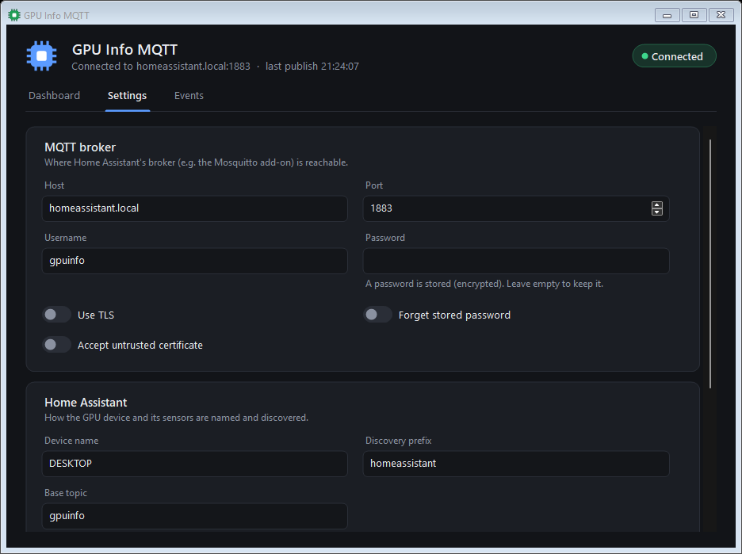
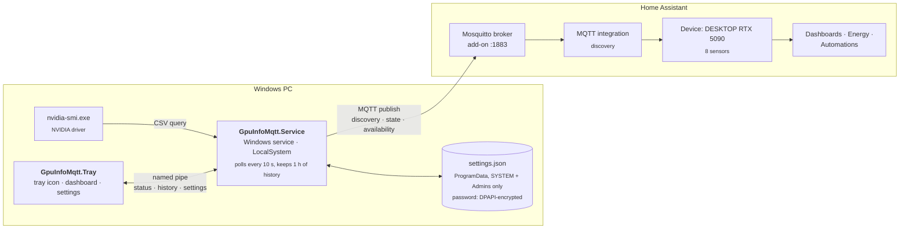

<div align="center">

# GPU Info MQTT

**Bring your NVIDIA GPU into Home Assistant.**


</div>

A small Windows service reads **power draw, memory, temperature, fan speed and load** from `nvidia-smi` and publishes them to Home Assistant over MQTT. The sensors appear automatically. A tray app shows a live dashboard and holds the settings.


<sub>Screenshot with demo data. The window follows the Windows light/dark app theme.</sub>

It was built mainly for **Home Assistant**, so that a gaming / AI / render PC can take part in automations: track the GPU's energy use, get notified when a long render finishes, or switch on a fan when the card runs hot.

## Install in 5 steps

You need **Windows 10/11 x64** with an **NVIDIA driver**, and **Home Assistant**. Nothing else: the installer includes the .NET runtime.

**1. Add the MQTT broker to Home Assistant.**
Go to **Settings → Add-ons → Add-on store**, install **Mosquitto broker** and start it.

**2. Turn on the MQTT integration.**
Go to **Settings → Devices & services**. MQTT shows up as *Discovered*. Click **Configure → Submit**.

**3. Create a user for the PC.**
Go to **Settings → People → Users → Add user**, for example `gpuinfo` with a strong password, and turn off *Can log in*.

**4. Install on the PC.** Download **`GpuInfoMqtt-Setup-x.y.z.exe`** from [Releases](../../releases/latest) and run it. It is signed by *DevelMagic s.r.o.* and installs the service and the tray app. Running it again upgrades in place and keeps your settings.

**5. Connect.** Click the new tray icon next to the clock (it may be under **^**) and open **Settings**. Enter the Home Assistant address, `1883`, and the user from step 3, then click **Save & reconnect**. The badge turns green.

**Done.** Under **Settings → Devices & services → MQTT** you'll find a device like **"DESKTOP RTX 5090"** with 8 sensors.

> Not on Home Assistant OS? Any MQTT broker works. Use its address in step 5 and skip steps 1–3.



## How the data flows



| Topic | Payload | Retained |
|---|---|---|
| `homeassistant/sensor/gpuinfo_<gpu>/<sensor>/config` | Discovery config for each of the 8 sensors | yes |
| `gpuinfo/<device>/<gpu>/state` | `{"power":38.9,"power_limit":600,"memory_used":2453,"memory_total":32607,"memory_percent":7.5,"temperature":48,"fan":0,"utilization":2}` | no |
| `gpuinfo/<device>/status` | `online` / `offline` (last will) | yes |

When Home Assistant restarts, discovery is re-sent automatically. When the PC is off, the sensors show *unavailable* instead of stale values.

### Sensors per GPU

| Sensor | Unit | Notes |
|---|---|---|
| Power | W | `device_class: power` |
| Power limit | W | diagnostic |
| Memory used | MiB | `device_class: data_size` |
| Memory total | MiB | diagnostic |
| Memory usage | % | |
| Temperature | °C | `device_class: temperature` |
| Fan speed | % | 0 % at idle is normal: modern cards stop their fans |
| GPU utilization | % | |

With several GPUs, each one becomes its own device.

## Ideas for Home Assistant

**GPU energy in kWh:** go to **Settings → Devices & services → Helpers → Create helper → Integral sensor**. Use the GPU *Power* sensor as input, the *Left* method, metric prefix `k` and time unit hours. Then add the result to **Energy → Individual devices**.

**Notify when a render or training job finishes:**

```yaml
automation:
  - alias: "GPU job finished"
    trigger:
      - platform: numeric_state
        entity_id: sensor.desktop_rtx_5090_gpu_utilization
        below: 10
        for: "00:03:00"
    action:
      - service: notify.mobile_app_phone
        data:
          message: "The GPU is idle again: your job is done."
```

**Hot GPU alert:** trigger on `sensor.desktop_rtx_5090_temperature` above `83` for 1 minute.

Entity IDs depend on your device name. Check them on the device page.

## The tray app

| | |
|---|---|
|  |  |

- **Tray icon colour:** green = publishing, orange = connecting, red = error, grey = disabled or service not running. Hover it for temperature, power and fan.
- **Dashboard:** live tiles and a power chart for 5 min, 15 min or 1 h, with now / average / peak / energy. Hover the chart for exact values.
- **Settings:** broker, credentials, TLS, Home Assistant naming, polling interval.
- **Events:** connection history and errors, including which Windows user changed the settings.

## Security

The service runs as **LocalSystem**, and the tray app runs as a normal user. The MQTT credentials are kept away from other users and processes:

| Concern | Mitigation |
|---|---|
| **Password at rest** | Encrypted with **Windows DPAPI in the service account's scope**. Only the service can decrypt it, so a copied `settings.json` is useless. |
| **Settings file access** | `%ProgramData%\GpuInfoMqtt` is restricted to **SYSTEM + Administrators**. The service re-applies this ACL on every start. |
| **Password sent back to the tray** | Never. The tray can only set it and see whether one is stored. |
| **Credential redirect** | Changing the broker host, port, username or TLS requires entering the password again. |
| **Privilege escalation via nvidia-smi path** | Only `nvidia-smi.exe` from `System32` or `Program Files\NVIDIA Corporation\NVSMI` is executed, never anything found through `PATH`. |
| **Who can talk to the service** | Interactive local users only. Network logons are denied, requests are capped at 64 KB, and settings changes are logged with the user name. |
| **Pipe-name squatting** | The tray checks that the pipe is owned by SYSTEM/Administrators and connects with *Identification* level, so a fake server can neither read the password nor act as the user. |
| **Credentials on the wire** | Plain MQTT (1883) is unencrypted on your LAN. Enable **Use TLS** (8883) if your broker supports it. |

## Uninstall

Go to **Settings → Apps → Installed apps → GPU Info MQTT → Uninstall**. Your settings in `C:\ProgramData\GpuInfoMqtt` are kept. Delete that folder as an administrator if you want them gone.

## Development

| | |
|---|---|
| **CI** | `.github/workflows/ci.yml` builds and runs the unit tests on every push and pull request. |
| **Release** | Push a tag `vX.Y.Z`, and `.github/workflows/release.yml` builds the self-contained apps, signs them and the installer with **Azure Artifact Signing** (same account as sf-querynator), and attaches `GpuInfoMqtt-Setup-X.Y.Z.exe` + `.sha256` to the GitHub Release. Run it manually without a tag for a test build. |
| **Local installer** | `.\build\build.ps1` (needs [Inno Setup 6](https://jrsoftware.org/isdl.php)); `-Sign` signs if the signing environment variables are set (see `build/sign.ps1`). |
| **Without installer** | `.\install.ps1` / `.\uninstall.ps1` from an elevated PowerShell (needs the .NET 9 SDK). |

```powershell
dotnet build GpuInfoMqtt.sln -c Release
dotnet test GpuInfoMqtt.sln -c Release

# Run a dev copy next to an installed service without touching its pipe or settings:
$env:GPUINFOMQTT_PIPE = "GpuInfoMqttDev"; $env:GPUINFOMQTT_DATA = "$PWD\devdata"
.\src\GpuInfoMqtt.Service\bin\Release\net9.0-windows\win-x64\GpuInfoMqtt.Service.exe
# in a second shell, with the same GPUINFOMQTT_PIPE:
.\src\GpuInfoMqtt.Tray\bin\Release\net9.0-windows\win-x64\GpuInfoMqtt.Tray.exe
```

`GPUINFOMQTT_THEME=dark|light` forces the tray theme.

| Project | Purpose |
|---|---|
| `src/GpuInfoMqtt.Service` | Worker service: nvidia-smi polling, MQTT ([MQTTnet](https://github.com/dotnet/MQTTnet)), discovery, history, named-pipe server, settings storage |
| `src/GpuInfoMqtt.Tray` | WinForms tray app with custom-drawn dashboard and chart |
| `src/GpuInfoMqtt.Shared` | Pipe protocol and data contracts |
| `tests/GpuInfoMqtt.Tests` | xUnit tests: nvidia-smi parsing, path allow-list, validation, encrypted settings |
| `installer/` | Inno Setup script (service install/upgrade/removal, tray autostart) |

Service logs go to the Windows Event Log (*Application*, source `GpuInfoMqtt`).
