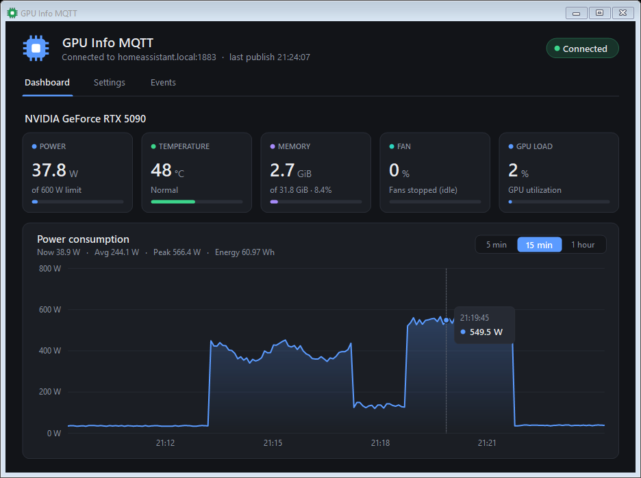
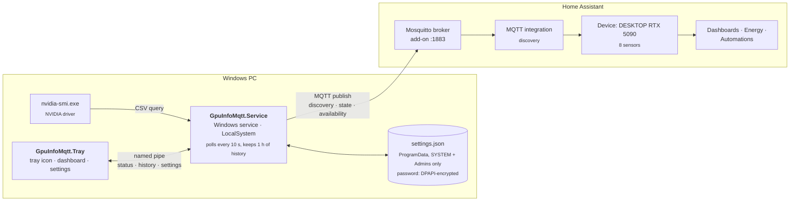
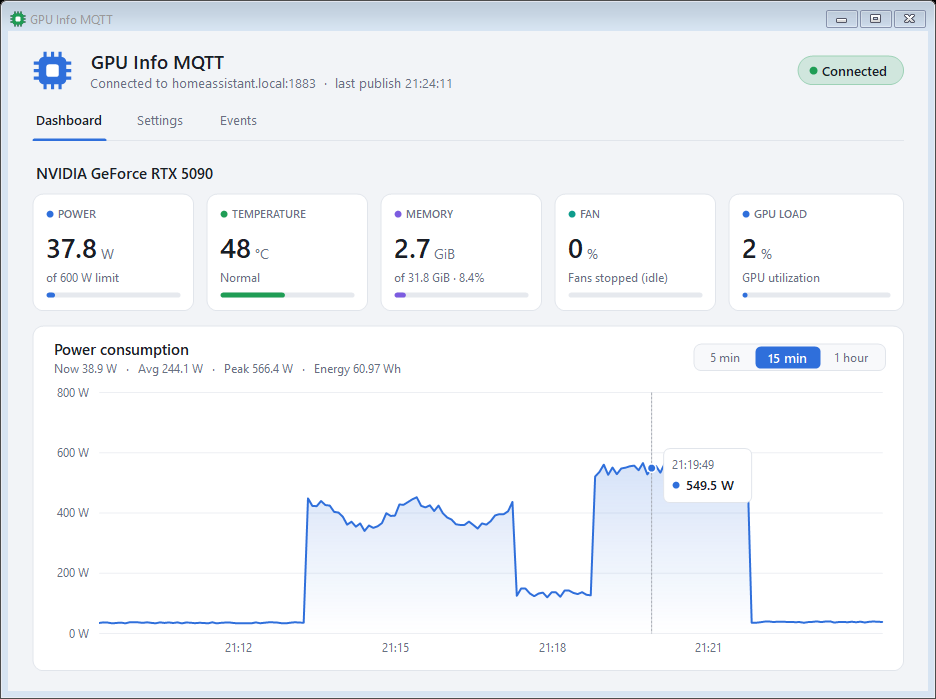
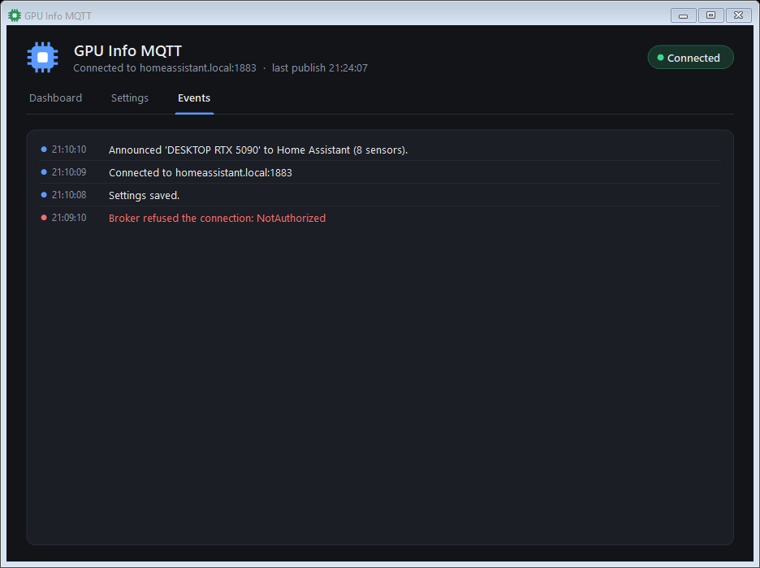

# GPU Info MQTT

**Bring your NVIDIA GPU into Home Assistant.** GPU Info MQTT is a small Windows service that reads power draw, memory, temperature, fan speed and load from `nvidia-smi` and publishes them to Home Assistant over MQTT. Sensors appear automatically through MQTT discovery. A tray app shows a live dashboard and holds all the settings.



<sub>Screenshot with demo data. The window follows the Windows light/dark app theme.</sub>

## Why

It was built mainly for **Home Assistant**, so that a gaming / AI / render PC can take part in automations:

- show GPU power on the energy dashboard and track how much the PC really costs
- turn on a fan or the AC when the GPU gets hot
- notify you when a long render or training run finishes (GPU load drops)
- spot a GPU that never idles (a stuck process or a crypto-miner)

## How the data flows



| Topic | Payload | Retained |
|---|---|---|
| `homeassistant/sensor/gpuinfo_<gpu>/<sensor>/config` | Discovery config for each of the 8 sensors | yes |
| `gpuinfo/<device>/<gpu>/state` | `{"power":38.9,"power_limit":600,"memory_used":2453,"memory_total":32607,"memory_percent":7.5,"temperature":48,"fan":0,"utilization":2}` | no |
| `gpuinfo/<device>/status` | `online` / `offline` (last will) | yes |

When Home Assistant restarts, the service sees `homeassistant/status = online` and re-sends discovery.

### Sensors per GPU

| Sensor | Unit | Notes |
|---|---|---|
| Power | W | `device_class: power`, usable in the Energy dashboard via an integration helper |
| Power limit | W | diagnostic |
| Memory used | MiB | `device_class: data_size` |
| Memory total | MiB | diagnostic |
| Memory usage | % | |
| Temperature | °C | `device_class: temperature` |
| Fan speed | % | 0 % at idle is normal: modern cards stop their fans |
| GPU utilization | % | |

Multiple GPUs are supported. Each one becomes its own Home Assistant device.

## Setting it up with Home Assistant, step by step

### 1. Install the MQTT broker in Home Assistant

1. **Settings → Add-ons → Add-on store**, search for **Mosquitto broker**, then **Install**.
2. Turn on **Start on boot** and **Watchdog**, then **Start**.

> Not on Home Assistant OS? Any MQTT broker works (Mosquitto in Docker, EMQX, …). Use its host and port in step 4.

### 2. Enable the MQTT integration

1. **Settings → Devices & services**. Home Assistant usually shows **MQTT** as *Discovered*. Click **Configure → Submit**.
2. If it isn't discovered, use **Add integration → MQTT** and pick the Mosquitto add-on.

Discovery is enabled by default with the prefix `homeassistant`. Keep it.

### 3. Create a user for the service

1. **Settings → People → Users → Add user** (enable *Advanced mode* in your profile if you don't see the Users tab).
2. Name it, for example, `gpuinfo`, set a strong password, and turn **off** *Can log in*. It only needs MQTT access.

The Mosquitto add-on accepts Home Assistant users, so no broker configuration is needed.

### 4. Install GPU Info MQTT on the Windows PC

Requirements: Windows 10/11 x64, an NVIDIA driver, and the [.NET 9 SDK](https://dotnet.microsoft.com/download/dotnet/9.0) to build.

From an **elevated** PowerShell in the repository folder:

```powershell
.\install.ps1
```

This does the following:
- builds both apps and copies them to `C:\Program Files\GpuInfoMqtt`
- creates the **GpuInfoMqtt** Windows service (delayed auto-start, restarts on failure) and starts it
- registers the tray app to start at logon and launches it

### 5. Connect it

1. Click the tray icon (look under the **^** arrow next to the clock) and open the **Settings** tab.
2. **Host:** the Home Assistant address, for example `homeassistant.local` or `192.168.1.10`. **Port:** `1883`.
3. **Username / Password:** the user from step 3.
4. **Save & reconnect.** The status pill turns green and shows **Connected**.


### 6. Find the sensors in Home Assistant

**Settings → Devices & services → MQTT → devices → "DESKTOP RTX 5090"** (your PC name + GPU model). It has 8 entities. Power limit and memory total are listed under *Diagnostic*.

If the PC is shut down, the entities show *unavailable* (via the MQTT last will) instead of keeping stale values.

### 7. Ideas: Energy dashboard and automations

**Count GPU energy (kWh):** go to **Settings → Devices & services → Helpers → Create helper → Integral sensor**. Pick the GPU *Power* sensor as input, choose the *Left* method, set the metric prefix to `k`, and use hours as the time unit. Then add the new kWh sensor to **Energy → Individual devices**.

**Notify when a render finishes:**

```yaml
automation:
  - alias: "GPU job finished"
    trigger:
      - platform: numeric_state
        entity_id: sensor.desktop_rtx_5090_gpu_utilization
        below: 10
        for: "00:03:00"
    condition:
      - condition: numeric_state
        entity_id: sensor.desktop_rtx_5090_power
        below: 80
    action:
      - service: notify.mobile_app_phone
        data:
          message: "The GPU is idle again: your render or training job is done."
```

**Hot GPU alert:** use a `numeric_state` trigger on `sensor.desktop_rtx_5090_temperature` above `83` for 1 minute.

Entity IDs depend on your device name. Look them up on the device page.

## The tray app

| | |
|---|---|
|  |  |

- **Tray icon colour:** green = publishing, orange = connecting, red = error, grey = disabled or service not running. Hover it for temperature, power and fan.
- **Dashboard:** live tiles and a power chart for 5 min, 15 min or 1 h, with now / average / peak / energy (Wh). Hover the chart for exact values.
- **Settings:** broker, credentials, TLS, Home Assistant naming, polling interval.
- **Events:** connection history and errors, including which Windows user changed the settings.

The service keeps sampling (and the chart keeps its last hour of data) even while the tray window is closed.

## Security

The service runs as **LocalSystem**, and the tray app runs as a normal user. The design keeps the MQTT credentials out of reach of other users and processes:

| Concern | Mitigation |
|---|---|
| **Password at rest** | Encrypted with **Windows DPAPI in the service account's user scope** (LocalSystem). Only code running as the service can decrypt it. A copied `settings.json` is useless on its own. |
| **Settings file access** | `%ProgramData%\GpuInfoMqtt` is restricted to **SYSTEM + Administrators** (inheritance removed). The service re-applies this ACL on every start. |
| **Password in transit to the tray** | Never sent. The pipe API is write-only for the password; the tray only learns whether one is stored. |
| **Credential redirect** | Changing the broker host, port, username, or weakening TLS requires entering the password again. Otherwise a local user could point the service at their own broker and receive the stored password. |
| **Privilege escalation via nvidia-smi path** | The service only executes `nvidia-smi.exe` from `System32` or `Program Files\NVIDIA Corporation\NVSMI`, resolved by full path, never through `PATH`. |
| **Who can talk to the service** | Named pipe ACL: interactive local users only. Network logons are explicitly denied. Requests are capped at 64 KB, and every settings change is logged with the Windows user name. |
| **Pipe-name squatting** | The tray checks that the pipe is owned by SYSTEM/Administrators before sending anything, and connects with *Identification* impersonation level, so a fake server can neither read the password nor act as the user. |
| **Credentials on the wire** | Plain MQTT (1883) sends the password unencrypted on your LAN. Enable **Use TLS** (port 8883) if the broker supports it. Leave *Accept untrusted certificate* off unless you use a self-signed cert. |

Any interactively logged-on user can still *change* non-credential settings (topics, interval) or disable publishing. On a shared PC, treat that as by design.

## Uninstall

```powershell
.\uninstall.ps1                  # keeps settings
.\uninstall.ps1 -RemoveSettings  # also deletes C:\ProgramData\GpuInfoMqtt
```

## Development

```powershell
dotnet build GpuInfoMqtt.sln -c Release

# Run a dev copy next to an installed service without touching its pipe or settings:
$env:GPUINFOMQTT_PIPE = "GpuInfoMqttDev"; $env:GPUINFOMQTT_DATA = "$PWD\devdata"
.\src\GpuInfoMqtt.Service\bin\Release\net9.0-windows\win-x64\GpuInfoMqtt.Service.exe
# in a second shell, with the same GPUINFOMQTT_PIPE:
.\src\GpuInfoMqtt.Tray\bin\Release\net9.0-windows\win-x64\GpuInfoMqtt.Tray.exe
```

`GPUINFOMQTT_THEME=dark|light` forces the tray theme.

| Project | Purpose |
|---|---|
| `src/GpuInfoMqtt.Service` | Worker service: nvidia-smi polling, MQTT ([MQTTnet](https://github.com/dotnet/MQTTnet)), discovery, history, named-pipe server, settings storage |
| `src/GpuInfoMqtt.Tray` | WinForms tray app with custom-drawn dashboard and chart |
| `src/GpuInfoMqtt.Shared` | Pipe protocol and data contracts |

Service logs go to the Windows Event Log (*Application*, source `GpuInfoMqtt`).
